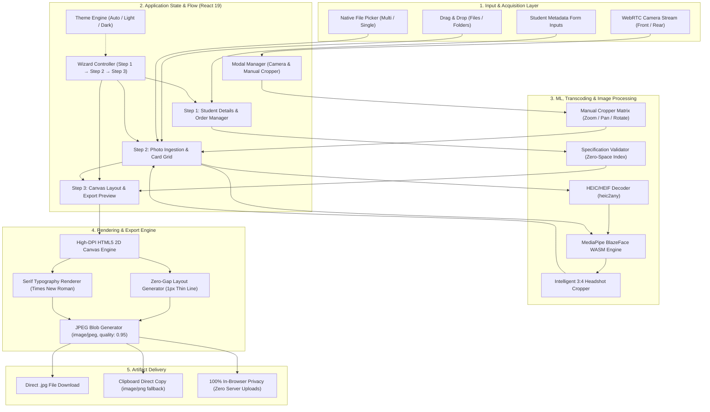

# FYP Photo Arranger

A private, client-side browser application designed to help university students prepare, crop, arrange, and export official final year project submission photos adhering strictly to official **Final Year Project – Group Photo Submission Guidelines**.

[](LICENSE)
[](#-privacy--security-model)
[](https://vitejs.dev/)
[-orange.svg)](https://developers.google.com/mediapipe)

---

## 🏗️ System Architecture

The application operates entirely within the user's browser runtime. It integrates modern Web APIs, WebAssembly ML models, client-side transcoding, and an HTML5 2D Canvas rendering engine to eliminate any reliance on backend infrastructure or cloud storage.



### Architectural Highlights

1. **Zero-Cloud Privacy**: Photos, names, and index numbers never leave the user's device. No telemetry, third-party analytics, or external server uploads exist.
2. **Offline-First WASM Face Detection**: Google MediaPipe BlazeFace models run client-side via WebAssembly (`@mediapipe/tasks-vision`) to locate facial landmarks and automatically compute the ideal 3:4 portrait crop box.
3. **Multi-Format Ingestion**: Supports JPG, PNG, WebP, GIF, BMP, TIFF, SVG, and iPhone HEIC/HEIF files (decoded on-the-fly via dynamic `heic2any` import).
4. **Hardware Media Capture**: Directly integrates with device cameras via WebRTC `navigator.mediaDevices.getUserMedia`, allowing instant capture with front/rear switching and framing guides on mobile and desktop.
5. **High-Resolution Canvas Compositor**: Programmatically draws all student photos with uniform dimensions, zero horizontal gaps with a crisp 1px dividing line, and authentic Serif (`Times New Roman`) typography.

---

## 📋 Adherence to Official Specification

The application enforces and validates all guidelines specified in the university requirements:

1. **Photo Requirements**
   - Headshots must show only the face (tight, professional framing).
   - Casual, selfie, or full-body photos are flagged.
   - Built-in intelligent client-side face detector auto-centers and frames the headshot.
   - Interactive manual cropper allows custom adjustments with alignment guides (eye level line, head oval).

2. **Name and Index Number Format**
   - **Index number is placed ABOVE student's name**.
   - **Student's name with initials is placed BELOW index number**.
   - **Zero spaces around index number**: Real-time validation warns and auto-strips spaces (e.g., `214001A`).
   - Initials formatter helper (e.g., `A.B.C. Perera`).

3. **Photo Arrangement**
   - Photos arranged in the exact same order as listed in the Final Year Project Details Form.
   - Reorder controls (Move Left / Move Right) to adjust member sequence.
   - **Identical Photo Sizing**: Enforced programmatically by the canvas engine.

4. **Layout and Formatting**
   - Crisp, uniform borders and locked **Serif Typography** (`Times New Roman`).
   - Standard **Zero-Gap Layout with a 1px Thin Dividing Line** between photos.

5. **Final Submission Rules**
   - **Group Project**: Generates **one combined image** containing all group members. Member #1 is designated as the **Group Leader**.
   - **Individual Project**: Generates a single submission image.
   - **Strict JPEG Output**: All downloads are exported strictly as high-resolution `image/jpeg` with `.jpg` extension.

---

## 🚀 Key Features

- **Guided 3-Step Workflow**: Clean, distraction-free stepped flow (1. Details $\rightarrow$ 2. Photos $\rightarrow$ 3. Arrange & Export).
- **Flexible Photo Ingestion & Professional Photo Reminders**:
  - **Drag and Drop**: Drop photos onto individual student slots or drop multiple photos at once to populate subsequent members sequentially.
  - **Native File Picker**: "Browse File" buttons on each student card with built-in format filtering.
  - **Professional Photo Reminders**: Clear guideline callouts preventing accidental selfie or casual snapshot uploads.
  - **Device Camera with Live Positioning Suggestions**:
    - Real-time in-browser pose analyzer detecting head distance, tilt, centering, eye level line, and lighting.
    - Live guidance prompts: *"Move closer"*, *"Step back"*, *"Keep head upright (level eyes)"*, *"Raise camera to eye level"*, *"Face camera directly"*.
    - Interactive 3:4 portrait guide frame with real-time green alignment states and ready shutter pulse.
    - Front/rear camera switching, freeze review, and instant BlazeFace alignment.
- **Intelligent Face Cropping & Manual Override**:
  - MediaPipe BlazeFace detection frames headshots automatically.
  - Interactive crop modal with zoom (1x to 2.5x), pan, 90° rotation, and horizontal mirror flip.
- **Fully Responsive (Mobile & Desktop)**:
  - Mobile touch targets $\ge 44\text{px}$.
  - iOS-optimized inputs ($16\text{px}$ font to prevent unwanted viewport zooming).
  - Adaptive grid and touch-friendly controls across phones, tablets, and desktops.
- **Automatic Light/Dark Theme**:
  - Automatically matches system OS theme preference (`prefers-color-scheme`).
  - Quick-toggle cycle: **Auto $\rightarrow$ Light $\rightarrow$ Dark** with persistent local state.
- **Strict Compliance Checklist**: Real-time validation providing instant green checkmarks when all guideline rules are satisfied before export.
- **1-Click Sample Demo Data**: Quickly populate realistic student details and SVG vector headshots to verify the workflow immediately.

---

## 🛠️ Getting Started

### Prerequisites

- [Node.js](https://nodejs.org/) (v18+)
- [npm](https://www.npmjs.com/)

### Installation

```bash
# Clone the repository
git clone https://github.com/RandithaK/FYP_Photo_Arranger.git
cd FYP_Photo_Arranger

# Install dependencies
npm install
```

### Development Server

```bash
npm run dev
```

Visit `http://localhost:5173` in your browser.

### Production Build & Lint

```bash
# Run linter
npm run lint

# Build production bundle
npm run build
```

The optimized static assets will be output to the `dist/` folder, ready for deployment to GitHub Pages, Netlify, Vercel, or any static host.

---

## 🔒 Privacy & Security Model

- **No Remote Processing**: All image processing, face detection, HEIC transcoding, and canvas rendering happen 100% in the client browser.
- **Zero Server Uploads**: Student photos and academic index numbers are never transmitted over the network.
- **Sandboxed**: No cookies, tracking beacons, or third-party analytic scripts are included.

---

## 📄 License

This project is licensed under the [MIT License](LICENSE).
